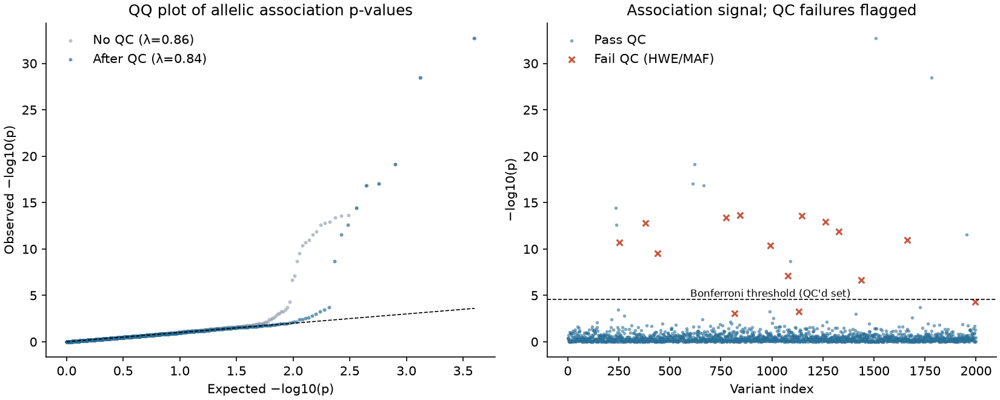

# Case-Control Variant Association with Hardy-Weinberg QC

A small, tested Python implementation of the core statistics behind a genome-wide association study (GWAS), built to answer one practical question:

> **How much does genotyping-error QC change which variants you call significant?**

On a simulated cohort (2,000 variants, 1,500 cases, 1,500 controls) the pipeline shows that skipping Hardy-Weinberg QC turns a clean result into one dominated by false positives.



## What it does

| Step | Method | Code |
|------|--------|------|
| Simulate genotype counts | null, causal (OR 1.4-1.9) and artifact variants | `variant_assoc/simulate.py` |
| Hardy-Weinberg QC | exact test, Wigginton et al. 2005, in controls | `hwe_exact_pvalue` |
| Association | Fisher's exact test on allele counts; odds ratio with Woolf 95% CI | `allelic_test` |
| Multiple testing | Bonferroni and Benjamini-Hochberg | `bonferroni`, `benjamini_hochberg` |
| Calibration | genomic inflation factor (lambda GC) | `genomic_inflation_factor` |

**Artifact variants** model a differential genotyping error: most control hom-alt individuals are miscalled as heterozygous. That lowers the control alt-allele frequency, creating a real-looking association *and* a heterozygote excess that HWE in controls can detect.

## Results (seed 42)

| | No QC | After HWE/MAF QC |
|---|---:|---:|
| Variants tested | 2,000 | 1,985 |
| Significant at BH q < 0.05 | 26 | 10 |
| True causal variants found | 10 / 10 | 10 / 10 |
| False positives | **16** (14 are genotyping artifacts) | **0** |

All 15 planted artifacts were removed by HWE QC (exact p < 1e-6 in controls); no causal variant was lost. Bonferroni on the QC'd set finds 9 of the 10 causal variants, as expected from its stricter control.

**A note on lambda GC.** It comes out at 0.84-0.86 rather than 1. That is expected here: Fisher's exact test is conservative on discrete counts, and the simulation has no population structure. It is *not* a sign of a bug. Real data usually shows lambda > 1.

## Quick start

```bash
pip install -r requirements.txt
python run_analysis.py            # writes results/variant_results.csv, summary.json, association_plots.png
python -m pytest                  # 16 tests
python verify_task.py             # reproduces the worked example in TASK.md
```

Options: `--seed`, `--n-variants`, `--n-cases`, `--n-controls`, `--fdr`, `--hwe-threshold`, `--maf-threshold`.

## Tests

The tests check the statistics against independent references rather than against themselves:

- exact HWE p-values vs. brute-force enumeration of the exact distribution (Haldane's formula);
- Benjamini-Hochberg vs. `scipy.stats.false_discovery_control`;
- Fisher p-values and odds ratios vs. hand calculation;
- an end-to-end check that QC removes every planted artifact and keeps the causal signal.

## Worked example

[`TASK.md`](TASK.md) is a self-contained 8-variant problem (answer verified by `verify_task.py`) showing a case where removing one artifactual variant changes whether a neighbouring variant is significant.

## Limitations

- Simulated data only; there is no population stratification, covariate adjustment or imputation. Real GWAS use logistic regression with ancestry principal components (PLINK, REGENIE, SAIGE).
- The allelic test assumes HWE; the QC step exists precisely to protect that assumption.
- Fixed QC thresholds (HWE p < 1e-6 in controls, MAF >= 1%) are common defaults, not universal rules.

## References

- Wigginton JE, Cutler DJ, Abecasis GR (2005). A note on exact tests of Hardy-Weinberg equilibrium. *Am J Hum Genet* 76:887-893.
- Benjamini Y, Hochberg Y (1995). Controlling the false discovery rate. *J R Stat Soc B* 57:289-300.
- Anderson CA et al. (2010). Data quality control in genetic case-control association studies. *Nat Protoc* 5:1564-1573.
