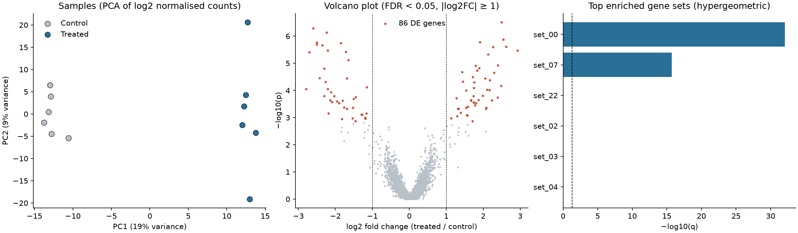

# RNA-seq Differential Expression and Gene-Set Enrichment

A compact, tested pipeline that goes from a raw count matrix to differentially expressed genes and enriched pathways, written from first principles in NumPy/SciPy so every step is visible.



## What it does

| Step | Method | Code |
|------|--------|------|
| Simulate an experiment | negative-binomial counts, mean-dependent dispersion, varying library sizes, planted DE genes and enriched sets | `rnaseq_de/simulate.py` |
| Normalise | median-of-ratios size factors (DESeq2-style) | `size_factors_median_of_ratios` |
| Sample QC | PCA of log2 normalised counts | `rnaseq_de/qc.py` |
| Differential expression | Welch's t-test on log2(norm + 1), low-expression filter, Benjamini-Hochberg | `welch_de_test` |
| Enrichment | hypergeometric over-representation test, universe = testable genes | `hypergeometric_enrichment` |

## Results (seed 1; 3,000 genes, 6 vs. 6 samples, 120 truly DE genes)

- **DE calls** (q < 0.05 and |log2FC| >= 1): 86 genes, of which **85 are truly DE and 1 is a false positive** (empirical FDR 1.2%).
- **Sensitivity:** 71% of the 120 planted DE genes. The 35 misses skew towards lower expression (median normalised mean count 70 vs. 185 for detected genes) and smaller true fold changes (26 of 35 have |log2FC| < 1.5), where six replicates per group cannot overcome the count noise.
- **Normalisation:** estimated size factors correlate 0.9995 with the simulated library sizes (log scale).
- **Enrichment:** the two planted sets are the only significant hits. `set_00` (31 of 60 genes DE, q = 9e-33) and `set_07` (20 of 58 testable genes DE, q = 2e-16). The next set has q = 1.

## Quick start

```bash
pip install -r requirements.txt
python run_analysis.py            # writes results/de_results.csv, enrichment.csv, summary.json, rnaseq_overview.png
python -m pytest                  # 10 tests
python verify_task.py             # reproduces the worked example in TASK.md
```

Options: `--seed`, `--n-genes`, `--n-per-group`, `--fdr`, `--lfc`.

## Design notes

- **Why median-of-ratios?** A few highly expressed, changing genes would distort total-count scaling; the median over genes is robust to them.
- **Why restrict the enrichment universe to testable genes?** Using all genes as the background counts untestable genes as "not DE" and inflates significance. `hypergeometric_enrichment` intersects the sets with the universe first (covered by a test).
- **Independent filtering:** genes with mean normalised count < 5 are not tested, which improves power after multiple-testing correction.

## Tests

- size factors against a hand-computed example and against known scaling of library size;
- the hypergeometric p-value against a direct `math.comb` calculation;
- end-to-end recovery of planted DE genes and planted enriched pathways.

## Worked example

[`TASK.md`](TASK.md) is a self-contained problem on a 6-gene table (answers verified by `verify_task.py`) that includes a subtle point: a gene excluded from size-factor estimation because of a zero count can still have the largest fold change.

## Limitations

- Simulated data; there is no real-world batch effect or outlier handling.
- The Welch t-test on log counts is a transparent baseline, not a replacement for negative-binomial models (DESeq2, edgeR, limma-voom), which share dispersion information across genes and are preferable with few replicates.
- Hypergeometric ORA ignores effect sizes and gene correlations; rank-based methods (GSEA) are a complementary choice.

## References

- Anders S, Huber W (2010). Differential expression analysis for sequence count data. *Genome Biol* 11:R106.
- Love MI, Huber W, Anders S (2014). Moderated estimation of fold change and dispersion for RNA-seq data with DESeq2. *Genome Biol* 15:550.
- Benjamini Y, Hochberg Y (1995). Controlling the false discovery rate. *J R Stat Soc B* 57:289-300.
